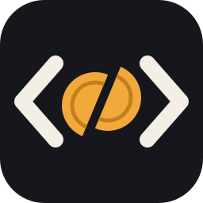

<p align="center"></p>

# broke-code

broke-code is a VS Code extension that runs a coding agent against LLM services without native tool calling.

Some services speak the OpenAI chat API but reject the `tools` request field. Agent extensions that rely on that field
fail against them. In broke-code, the model writes each tool call in the text of its reply, and the extension reads and
runs it. broke-code never sends `tools`, even to a service that supports them.

broke-code is a chat agent that reads and changes your workspace. Pick a model and ask a question or a change, with
files and folders attached. The model reads files, lists folders, searches the workspace, creates or edits files, and
runs shell commands until it is done.

- Each change opens as a diff and waits for you to click **Accept** or **Reject** in the chat. Auto-approval in your
  user settings skips that step.
- Each command waits for you to click **Run** or **Reject**, always.
- Plan mode asks the agent for a plan instead of changes.
- You can follow each step and stop the agent at any time. The model's reasoning shows collapsed above its answer, and
  a finished turn folds its steps under one row.
- You can retry, continue, or edit the last turn, see which files a turn changed, and undo those changes.
- broke-code saves your conversations, so you can come back to them.
- The model sees the name and description of each of your skills, and loads a skill's instructions when your task
  matches it.
- Type `/` at the start of a message to start a new conversation, choose the model, summarize the conversation, or pick
  a skill. The message `/<name> args` loads that skill with your arguments.
- In the Source Control view, a button writes a commit message for your staged changes.

## Install

The extension ID is `schalappe.broke-code`.

- In VS Code, install it from the
  [Visual Studio Marketplace](https://marketplace.visualstudio.com/items?itemName=schalappe.broke-code), or search for
  broke-code in the Extensions view.
- In VSCodium and other editors that use Open VSX, install it from
  [Open VSX](https://open-vsx.org/extension/schalappe/broke-code), or search for broke-code in the Extensions view.

Each release also attaches its `.vsix` file to [GitHub Releases](https://github.com/schalappe/broke-code/releases). To
install that file, run **Extensions: Install from VSIX...**.

## Requirements

- macOS. Version 1 supports macOS only. Windows and Linux are planned for version 2.
- VS Code 1.101 or later, or a compatible editor such as VSCodium.
- An LLM service with an OpenAI-compatible API, which means streaming `POST /v1/chat/completions` and `GET /v1/models`.
  Ollama works.

## Configure a provider

A provider is an LLM service that broke-code talks to. To add one, run **broke-code: Add provider** from the Command
Palette, or click its button in the chat panel. It offers two choices.

- **Ollama on this machine** adds `ollama` at `http://localhost:11434/v1`, with no key. If a provider named `ollama`
  already exists, the command selects it instead. Start Ollama first. broke-code does not check that it is running, and
  when it cannot reach Ollama, the chat shows the usual error, with **Open provider settings** and Retry.
- **Other OpenAI-compatible service** asks for a name, the base URL, and the API key. The base URL ends in the
  service's version path, such as `/v1`. You can leave the key empty.

The command adds the provider to your user settings and its key to the editor's secret storage, then the chat selects
the provider. Press Escape at any step to change nothing. To edit or remove a provider, or to set its `caFile`, edit
the settings.

You can also list your providers by hand under `brokeCode.providers` in your **user** settings (`settings.json`). Each
entry has a unique `name` and a `baseUrl`, the API root.

```json
"brokeCode.providers": [
  { "name": "ollama", "baseUrl": "http://localhost:11434/v1" },
  { "name": "Work", "baseUrl": "https://llm.example.com/v1" }
]
```

broke-code appends `/models` and `/chat/completions` to the base URL. It reads this list from your user settings only.
A workspace `settings.json` cannot override it, so a repository cannot send your key to another URL.

broke-code follows VS Code's proxy settings. It never follows an HTTP redirect, and reports one as an error. A request
that gets no response within 300 seconds fails as unreachable. broke-code cuts off a reply that sends nothing for 300
seconds.

## Reasoning effort

Next to the mode selector, the message box has a reasoning effort picker: **Default effort**, **Low effort**,
**Medium effort**, or **High effort**. Low, Medium, and High send `reasoning_effort` with every request to that model,
from the chat, a commit message, and **Edit selection**. Default sends nothing and leaves the choice to the provider.
broke-code remembers your pick for each model of each provider, in this workspace.

The model decides what an effort changes, and some ignore it. If the provider answers with an error, pick Default
again.

## Corporate or self-signed certificates

broke-code trusts the certificates your system trusts. A provider may use a certificate signed by a corporate or
self-signed authority that is not in the macOS Keychain. The chat then reports a certificate error that names the
provider. To fix it, add a `caFile` to that provider. It is an absolute or `~/` path to a PEM file that holds the
authority's certificate. One file can hold several certificates.

```json
{ "name": "Work", "baseUrl": "https://llm.example.com/v1", "caFile": "~/certs/company-ca.pem" }
```

The file adds to the system certificates for that provider only. It never replaces them. You cannot turn certificate
verification off.

## Set an API key

When you add a provider in `settings.json`, broke-code asks for its key. **Add provider** asks for the key as one of its
steps. To set, replace, or clear a key later, run **broke-code: Set API key** from the Command Palette and pick the
provider. For a provider that needs no key, such as Ollama, leave the box empty.

Keys live in the editor's secret storage (the macOS Keychain), never in `settings.json`. broke-code sends a key to its
own provider only, as a bearer token.

## Mention files and folders

Type `@` in the message box to attach a workspace file or folder. A menu lists up to 20 rows.

- First come the reserved names whose name starts with what you type after `@`, such as `@problems` (below).
- Then come the files and folders whose path contains what you type, ignoring case, shortest paths first. Folders end
  with `/`.

Move with the arrow keys, pick with Enter, Tab, or a click, and close the menu with Escape. If you typed the whole path
of the highlighted row, Enter sends the message instead of picking it again. A picked path goes into the
message as `@<path>`, spaces included. You can also type `@path` yourself. A typed path ends at the first space. An `@`
inside code, between backticks or in a fenced block, opens no menu and attaches nothing.

When you send the message, broke-code reads each mention and sends it to the model with your text.

- broke-code attaches a file whole. Past 2,000 lines, it attaches the first 2,000 with a note that says how many lines
  it left out.
- A folder attaches the names of its direct children, not their content and not deeper levels.
- broke-code attaches nothing for a binary file, a file over 1 MiB, a missing path, a path outside the workspace
  folders (symlinks included), or a path it cannot read (no permission, not a regular file). The model gets a note
  that says why, and the message still goes.

Each mention shows as a chip under your message, with what broke-code attached or why it attached nothing.

The menu lists files from the workspace folders. It leaves out the files your `files.exclude` setting hides, and
anything inside `node_modules`, `.git`, `dist`, `out`, or `build` folders. It lists at most 5,000 files. Past that, the
menu says the index is limited, and you can still type the path of a file it does not show. New and deleted files show
up in the menu without reloading the window.

### Mention the problems

`@problems` attaches the errors and warnings that VS Code holds for the workspace files, as the Problems panel shows
them. Each problem takes one line with its path, line, column, severity, message, and the tool that reported it.
broke-code leaves out information and hints. A language service may report only the files open in an editor, so open
a file to get its problems. With no error or warning, the chip says so in a neutral look and the message still goes.
The menu lists `@problems` first when what you type after `@` starts its name.

`problems` is a reserved name, so `@problems` never reads a workspace path. To mention a file named `problems`, write
`@./problems`. Picking that file in the menu writes it that way for you. A folder of that name is `@problems/` or
`@./problems`. In a multi-root workspace, `@problems/` and `@problems/<path>` reach a workspace folder named
`problems`, and `@problems` no longer does.

### Mention the uncommitted changes

`@diff` attaches the changes to your tracked files that you have not committed yet. It sends staged and unstaged
changes together, as one diff against the last commit (`git diff HEAD`). It leaves out the files git does not track
yet. To include one, run `git add` on it first.

Each workspace folder inside a git repository gets the changes under that folder only. In a multi-root workspace, a
line with the folder's name comes before each folder's diff. broke-code reads git through VS Code's built-in Git
extension. It cannot read a repository that this extension has not opened, such as one above the folder that the
extension asked you about. The menu lists `@diff` after `@problems`.

With nothing changed, the chip says so in a neutral look. In these cases the chip says why in the error color:

- no workspace folder is in a git repository;
- git is not available in VS Code;
- broke-code cannot read the diff, for example in a repository without a commit.

In a multi-root workspace, one folder's diff may fail while another folder has changes. broke-code then attaches the
changes it read and tells the model which folders failed and why. The chip shows the line count, then how many folders
failed ("9 lines, 1 folder failed"), in the error color. In every case the message still goes. Past 2,000 lines or
1 MiB, broke-code cuts the diff and adds a note that says how many lines it left out.

`diff` is a reserved name like `problems`. A file named `diff` is `@./diff`. In a multi-root workspace, `@diff/` and
`@diff/<path>` reach a workspace folder named `diff`, and `@diff` no longer does.

### Mention the selection

`@selection` attaches the text you selected in the active editor, as it stands when you send the message, with its
file and line range. The model gets `src/app.ts lines 10-12`, and the chip shows "src/app.ts 10-12, 3 lines".

To use it, select the lines, click in the message box, and send. The editor keeps its selection while the chat has the
focus. With several cursors, broke-code attaches only the primary selection. A selection that ends at the start of a
line does not count that line. Past 2,000 lines or 1 MiB, broke-code cuts the text and tells the model so.

broke-code attaches nothing in these cases, shows the chip in the error color, and still sends the message:

- no text editor is active;
- the selection is empty;
- the file is outside the workspace folders, is an untitled document, or is not a file (such as the diff of a change
  that waits for your approval).

`selection` is a reserved name like `problems`. A file named `selection` is `@./selection`.

## From the editor

Two entry points fill the chat's message box from the editor, and a third rewrites the selection in place.

When text is selected, the editor's context menu has a **broke-code** submenu with **Add selection to chat**, **Edit
selection**, and its presets **Refactor selection**, **Add documentation comments**, and **Add types**.

The first two send nothing. You read the draft, add to it, and send it yourself. Both open the chat panel, close
History if it is open, and put the focus in the message box. Both work while a reply runs, since they only edit the
draft.

- **broke-code: Add selection to chat** inserts `@selection ` at the cursor of the message box, with a space before it
  when needed. It is in the Command Palette, and in the editor's broke-code submenu. The editor keeps its selection,
  and `@selection` attaches the selection as it stands when you send.
- **Fix with broke-code** is a quick fix in the light bulb of each error or warning in a file inside the workspace
  folders. It puts `Fix this problem in @src/app.ts at line 12: <the message>` in the message box, with the file as a
  mention, the line, and the message on one line. It fills an empty box. If the box holds a draft, it adds the text on
  a new line after that draft. The file counts as one mention even when its path holds spaces. Information and hints
  get no quick fix.

The extension starts once the window has started, so the quick fix is there before you first open the chat. Without a
provider, the chat opens with a notification that asks you to add one, and broke-code drops the draft.

### Edit selection

**broke-code: Edit selection** asks for an instruction, such as "handle an empty list", and sends the selection to the
model selected in the chat in one request, with the lines around it as context. No agent turn runs and no conversation
is saved. It is in the Command Palette and in the editor's broke-code submenu, and has no keyboard shortcut.

- It works on the primary selection of a file you can write, or of an untitled document. A notification says so when
  nothing is selected, or when the document is read-only or of another kind.
- A notification shows while the model writes. Its **Cancel** stops the request.
- The rewrite opens in a diff: the document on the left, the document with the rewritten selection on the right.
  **Accept** and **Reject** sit in the diff's title bar. Closing the diff is a Reject.
- **Accept** changes the document, not the file on disk, and does not save it. One Undo restores it. If you changed the
  selected text or anything above it since you ran the command, even if you undid the change or pasted a copy of the
  same line, broke-code edits nothing and says so. Changes below the selection do not block it.
- If you change the selected text or anything above it while you type the instruction, broke-code sends nothing and
  says so.
- broke-code drops the model's reasoning, removes a code block around the code, and sets the indentation to the
  selection's. The model's line breaks become the document's.
- The request uses the chat's provider, model, and context size. If the file is long, broke-code sends as many lines
  before and after the selection as fit. If the selection alone does not fit, it sends nothing and says so.
- One edit runs per document at a time. It works while the chat replies.

Three presets run Edit selection with a fixed instruction and no input box. They are in the Command Palette and in the
editor's broke-code submenu:

- **broke-code: Refactor selection** makes the code simpler and easier to read, and keeps its behavior and public names.
- **broke-code: Add documentation comments** adds documentation comments in the style of the file's language, and
  changes nothing else.
- **broke-code: Add types** adds explicit type annotations where the language allows them, and changes nothing else.

A preset counts as the document's edit: until it ends, Edit selection and the other presets refuse to start on that
document, and say so.

## How the agent works

Each message starts an agent turn. The model may answer at once, or write a tool call in its reply. broke-code then
runs the tool, sends the result back, and asks again, until the model answers with text and no call.

The agent has three read tools. They run without asking you, inside the workspace folders and the folders of the
skills loaded in the conversation (see [Skills](#skills)).

- **read_file** reads a file, with the same limits as a mention. It refuses binary files and files over 1 MiB, and
  shows at most 2,000 lines. It can read a range of lines, so the agent reads on past the first 2,000: a cut read
  tells it the line to read on from, and the step's row shows the range after the path (`big.log 2001-4000`).
- **list_files** lists the direct children of a folder.
- **search** searches the workspace with ripgrep, either the copy your editor ships or the `rg` on your `PATH`. It
  skips hidden files, files that `.gitignore` ignores, and symlinks, and stops after 30 seconds.

The agent also has two write tools. They ask you first, and work inside the workspace folders only, never in a skill
folder outside them.

- **write_file** creates a file, or replaces a whole file.
- **edit_file** replaces one exact passage of a file. If the passage appears zero times or more than once, the tool
  refuses the edit and never guesses.

broke-code refuses a file tool's path outside the workspace and outside the folders of the loaded skills, and tells
the model why.

When the model asks to change a file, the editor opens a diff beside the chat, titled with the path. The left side
shows the file as the model planned to change it, and the right side shows the proposed text. The chat shows
**Accept** and **Reject** under the call, with an optional reason, and the lines the change adds and removes. If you
close the diff, **Show change** opens it again. Only the buttons decide: pressing Enter in the reason field does
nothing, so a note you type is never sent as a rejection by accident.

- **Accept** writes the change and closes the diff. The write is atomic, so the file holds either its old text or the
  new one, even after a crash.
- **Reject** closes the diff and writes nothing. The model reads that you rejected the change, with your reason if you
  gave one.

broke-code writes nothing if the file changed on disk since the model planned the change, or if an editor holds unsaved
changes to it. Save or revert them first. **Stop**, **New chat**, or opening another conversation while a change
waits closes the diff and writes nothing.

The mode selector under the message box sets how you approve changes.

- **Ask**, the default, waits for **Accept** or **Reject** on each change.
- **Auto-edit** applies changes without asking. No diff opens, and the chat marks each such step auto-approved.

The selector writes the user setting `brokeCode.autoApproveWrites`, where Auto-edit is `true`. It also follows that
setting, so a change you make in the settings editor shows in the selector too. Since it is a **user** setting, picking
Auto-edit in one window applies to every window and project. A workspace `settings.json` cannot turn it on. The
selector is disabled while the agent works. Commands always ask, in both modes.

The third mode, **Plan**, asks the agent for a plan instead of changes. The agent gets only the tools that change
nothing (**read_file**, **list_files**, **search**, **ask_user**, and **load_skill** when a skill is listed). It answers with a plan of the
changes, file by file, in order. broke-code writes nothing and runs no command. If the model still tries to write or
run a command, the chat shows a failed step that says the tool is not available in Plan mode, and the model goes on.

broke-code keeps Plan for the workspace, also after a reload, and writes no setting for it. When you leave Plan for Ask
or Auto-edit, broke-code writes the setting only if its value must change. If that write fails, the error shows and
Plan stays. A message you send in Plan stays a Plan turn until it ends.

To carry a plan out, click the button under the plan's answer: **Implement in Ask mode**, or **Implement in Auto-edit
mode** when `brokeCode.autoApproveWrites` is on. The label names the mode the setting holds. The click leaves Plan for
that mode, writes no setting, and sends the message "Implement the plan above." The agent then makes the changes, with
your approval of each write in Ask. The button shows while Plan is on, under the last answer of the conversation, once
no reply is in flight and that answer ended normally. It does not show after a stop, an error, or `/compact`. It is
disabled while **Send** would not act. You can still leave Plan with the selector and type your own message.

The agent can also run a shell command with **run_command**. It always asks you first, and no setting changes that.
The chat shows the whole command under the call, with its line breaks, and the folder it runs in when the model names
one. You get **Run**, **Reject**, and an optional reason.

- **Reject** runs nothing. The model reads that you rejected the command, with your reason if you gave one.
- **Run** starts the command with your shell, as `<shell> -c <command>`, not as a login shell. broke-code uses the
  shell of your default terminal profile. Without one, it uses `$SHELL`, and without that, `/bin/sh`. The command
  runs without a terminal, in the first workspace folder unless the model names another folder of the workspace. It
  cannot read input, because it gets end of file at once.

The model receives the exit code, then stdout and stderr, each cut to its first 2,000 lines and 1 MiB. broke-code
reports a command as an error if it exits with a code other than 0 or gets killed.

You can decide from the keyboard too. The Command Palette has **broke-code: Accept the proposed change**, **Run the
proposed command**, **Reject the proposed change or command**, **Show the proposed change**, **Stop the reply**, and
**New chat**. Each shows only when its button would. You can bind them in Keyboard Shortcuts. **⌃⌘B** shows the chat
and puts the focus in the message box (**broke-code: Focus the message box**, which you can rebind).

While a reply is in flight, **Escape** in an empty message box stops it, like **Stop**. With a menu open, Escape
closes the menu; with text in the box, it does nothing, so a draft never stops a turn. Under **Accept**/**Run** and
**Reject**, a dim line names their keys.

In the chat, **⌘Enter** accepts the change or runs the command, and **⌘Backspace** rejects it. They work while the
focus is in the chat but not in a field with text in it, so they never take over your typing; an empty message box
counts as empty. **⌘Backspace** sends the reason you typed, like **Reject**.

A command stops after 120 seconds. broke-code sends SIGTERM to its process group (the shell and the processes it
started that stayed in that group), then SIGKILL two seconds later. The model gets the output so far. To change that
limit, set `brokeCode.commandTimeoutSeconds` (at least 1) in your **user** settings. A workspace `settings.json` cannot
change it.

**Stop**, **New chat**, or opening another conversation cancels a command that waits for your click. If the command
already runs, they stop it the same way as the time limit. Once a command ends, broke-code stops the processes it left
running in the background in its process group, and tells the model so. To keep a server running, start it in your own
terminal. broke-code does not stop a process that leaves the group, for example with `setsid` or a daemon that
detaches. When VS Code closes the window or reloads the extensions, broke-code sends SIGKILL at once to every command
still running.

Unlike the file tools, a command can go outside the workspace. It runs with your rights, so it can read, change, or
delete anything you can. broke-code checks only the folder it starts in. Your approval is the guard, so read the whole
command before you click **Run**.

The agent can ask you a question with **ask_user**, in every mode. It is told to ask when your request names one
thing and several match, such as a function that two files define under the same name, instead of changing them all
or picking one. The chat shows the question where an approval shows, with a button for each answer the model proposes
(six at most), then a field and **Answer** for an answer of your own, up to 4,000 characters. Enter in the field
answers too.

- Your answer goes back to the model as the result of its call, and the turn goes on. Click the step's row to read it
  again.
- A message you send from the message box meanwhile is queued, as during an approval. It does not answer the
  question.
- **Stop**, **New chat**, and opening or deleting a conversation cancel the question, and the turn ends stopped. A
  question is never saved: after a reload, the conversation shows that turn as stopped.
- No notification tells you about a question while the chat is out of view.

Each tool call shows as a compact row under the model's text. The row shows the tool, its main argument (a path, a
search pattern, the whole command, or the first line of a question), and whether it worked with the size of its
result, or the exit code for a command. Click the row to see the result the model received.

Once an agent turn ends, its steps fold under one row above the final answer that says what they did, such as "Read 3
files, changed 1 file, ran 1 command, 1 failed (run_command)". The failed part comes last, in the error color, and
names each tool that failed, so a failure never hides in the closed row even when the answer claims success. A step
that failed or that you rejected counts only there: "changed 1 file" means a file changed. Files
count once however the model spelled their path (`a.ts`,
`./a.ts`), but not across letter case or an absolute against a relative path; changed files and commands are always
named, and the rest add up as "other steps". The row wraps in a narrow panel.
The answer then sits right under your message. Click the row to see the steps again. If you scrolled up to read, your
message stays where it is on screen when its turn folds, unless too little is left below to scroll. A turn with a
single step stays unfolded. The turn in progress never folds, so a running step and a change that waits for you always
show.

The agent turn ends when the model answers with text and no tool call. It also ends in these cases:

- you click **Stop**, at any step;
- the model writes three malformed tool calls in a row, and a message says so;
- the turn reaches 50 tool steps (or the limit you set), and a message says the turn reached the step limit;
- the next request would fill the model's context even with its older tool results left out (below), and a message
  asks you to start a new chat.

broke-code sends a malformed call back to the model with what is wrong, so the model can try again. It does the same
for an empty reply, which counts as a malformed call. The chat shows the malformed call as the model wrote it, in the
editor font with its line breaks, between the text around it.

You can keep typing while a turn runs. **Send** (or Enter) then queues the message under the message box instead of
sending it, up to 10 messages. Past about three, the queued messages scroll in their own box, so the conversation keeps
its room. If the queue cannot take a message, the message goes back to the message box.

When the turn ends with the model's answer, the first queued message goes out as if you had just sent it. broke-code
reads its mentions and loads its `/<skill>` at that point, and uses the provider, model, and mode of that moment. The
next message waits for that turn, and so on. Each queued message has **Edit** and **Remove**. **Edit** takes the
message out of the queue and puts it back in the message box, after what you are typing, unless it went out
meanwhile.

When a turn ends any other way (**Stop**, a failure, a limit), broke-code sends nothing more. The panel says the queue
is paused and why, and **Send now** on the first message sends it. A message you send yourself while the queue is paused goes
first, and the queue resumes when its turn ends with an answer.

**New chat**, `/new`, opening another conversation, and deleting the one shown put every queued message back in the
message box, one per paragraph, so you lose nothing you typed. broke-code never queues `/new`, `/model`, or
`/compact`. A message you queue while `/compact` runs goes out once the summary is done. The queue survives hiding the
panel but not a window reload.

### Notifications

A turn can run for minutes. When it ends, fails, or stops on a limit while the chat is not in view, VS Code shows a
notification. It shows one too when a file change or a command waits for your decision, naming the file or the first
line of the command. The chat is in view when the chat view is visible and the VS Code window has the focus. Working
in an editor of the same window, with the chat still visible, shows no notification.

Each notification has one button, **Show chat**, which shows the chat and nothing more. You still accept or reject in
the chat. A turn you stop shows no notification, and neither does **Generate commit message**, which shows its own
progress. VS Code cannot take a notification back, so one may still be there after you answered in the chat.

To turn the notifications off, set `brokeCode.notifications` to `false` in your **user** settings. A workspace
`settings.json` cannot change it.

```json
"brokeCode.notifications": false
```

### Retry or continue a turn

Once no reply is in flight, the chat shows **Retry** under the last reply of the conversation. It also shows
**Continue** when you stopped the turn with **Stop**, or when the turn reached the step limit or three malformed calls.
Both buttons are disabled while **Send** would not act, for example with no model, or while a mode change or an undo
runs.

**Retry** runs your last message again in place of its first attempt. It removes for good the replies, tool steps, and
any summary after that message. The model receives the message exactly as it did the first time, with its mentions and
its `/<skill>` text. broke-code does not read them again. The provider, model, mode, limits, instructions, and skills
are those of now.

Retry reverts nothing on disk. If the removed steps wrote a file or ran a command, or if **Undo changes** is offered
for that turn, the first click only asks. The chat says why, the button reads **Retry anyway**, and **Cancel** sits
beside it. To get the files back, click **Undo changes** first.

**Continue** removes nothing. It sends a new message, shown as "Continue", that asks the model to carry on from where it
stopped, with a fresh step budget. After a stop on a full context, the chat does not offer Continue. Summarize with
`/compact` or start a new chat instead. Neither button shows once `/compact` has summarized the conversation after your
last message. A turn that Retry or Continue starts sends the first queued message when it ends with an answer, as a
message you type does.

### Edit your last message

When the chat offers Retry, it also shows **Edit** under your last message. Clicking it changes nothing yet. The
message's text goes into the message box with its file and folder mentions, and the box takes the focus. If you were
typing something, the text goes after it, following a blank line.

The last turn, which is your message and every reply after it, dims under a line that says sending replaces them, with
**Cancel**. The line also says if that turn wrote files or ran commands, since sending does not revert them. To get the
files back, click **Undo changes** first.

Change the text and click **Send**. broke-code removes the old message and its replies for good, and sends the new one
as a message you type, reading its mentions and `/<skill>` now.

**Cancel** keeps the text in the box and removes nothing. So do these events:

- you start a new chat or open another conversation;
- a reply starts (Retry, Continue, or a queued message that goes out);
- you hide the panel or reload the window, which also clears the box.

The chat does not offer Edit once `/compact` has summarized the conversation after your last message.

### Recall an earlier message

In an empty message box, press ArrowUp to bring back your last message of the conversation, with its file and folder
mentions. Press ArrowUp again for older messages, and ArrowDown to come back; past your last message, the box empties.
In a message of several lines, the arrows first move the caret to the first or last line. Once you change the text,
the arrows move the caret again. Send it as is, or edit it first: it goes as a new message.

### See what a turn changed

**Changed files** shows under the last reply of the latest turn that wrote a file, above **Undo changes**. It lists
each file that turn created or edited, in the order the turn first wrote them. Each row shows the path, "created" or
"edited", and the lines added and removed since before the turn (`+2 −1`).

Click a row to open the file's diff beside the chat. The left side shows its text from before the turn, empty for a
file the turn created. The right side shows the file as it is now, with your unsaved edits and any change since the
turn. A file you deleted since opens no diff, and a notification says so.

The list follows the **Undo changes** button and goes when the button goes. An undo removes the files it put back and
keeps the ones it skipped. A file's diff tab closes when its row goes and when the window reloads. The list does not
show changes that commands made.

### Undo the changes of a turn

A change the agent writes goes straight to disk, outside the editor. Neither the editor's **Undo** nor Local History
(the **Timeline** view) sees it. Instead, the chat shows **Undo changes** under the last reply of the latest turn that
wrote a file. It shows whatever way the turn ended, also after **Stop**.

Click it to put each file that turn wrote back to its text from before the turn. broke-code deletes a file the turn
created. The chat then lists each file as restored, removed, or skipped with the reason.

broke-code skips a file, and leaves it exactly as it is, in these cases:

- the file changed since the turn wrote it, for instance because you edited it;
- an editor holds unsaved changes to it;
- broke-code can no longer write it.

The button stays, so you can fix that and click again to retry only the skipped files. The button stays until one of
these happens:

- a later turn writes a file, and that turn's button replaces it;
- **Retry**, or a send after **Edit**, removes that turn;
- you start a new chat or open another conversation;
- the window reloads.

broke-code keeps the text from before the turn in memory only, never on disk. After the button goes, use git to get
the text back.

The button does not undo or list commands. When the turn ran one, the chat says so beside the button. While the undo
runs, **Send** waits for it. Each step whose file the undo put back then says **undone**, also after a reload.
broke-code tells the agent that you undid the change, so it reads the file again instead of answering from the change.

## Context size and step limit

Next to the model picker, the panel header shows how much of the model's context the next request would use, in tokens
and as a percentage. It is an estimate. broke-code counts the characters of everything the request sends (the
instructions, your messages with their attachments, the model's answers, and the tool results, but not its reasoning)
and divides by the model's characters per token. That number starts at 4. Each reply that reports at least 1,000 prompt
tokens teaches broke-code the model's real number, and the estimate uses the lowest one seen, never under 2, so code
and text in other languages than English, which run near 3.5 characters per token, are not underestimated. broke-code
learns it for each model of each provider separately, from chat and commit message replies alike, and forgets it when
the window reloads. When the provider reports how many tokens the last reply used, the tooltip of that line shows the
reported counts too: "Last reply: 12,001 prompt tokens, 345 completion tokens". broke-code asks every provider for these
counts. A provider that refuses the request field gets the request again without it, and broke-code stops asking that
model until the window reloads.

Before each request of an agent turn, broke-code checks that estimate. If the request leaves less than one eighth of
the context for the reply, broke-code leaves the oldest tool results out of that request, as few as make it fit,
rounded up to a block of four, so that the requests that follow start with the same text and the provider can reuse
its cache. The model gets each result left out as a single line, `[result left out to save context: N lines]`.

broke-code always sends these whole:

- the last three tool steps sent;
- every skill load;
- every change you undid with **Undo changes**;
- your messages and the model's answers;
- a result shorter than that line.

The chat and the saved conversation keep every result whole. Only the request changes. While the next request leaves
results out, the panel says how many in the line above the message box, and the usage counts the request as broke-code would send it.

The token count turns bold from three quarters of the context size, and a line above the message box suggests
`/compact`, so you see the end coming. If the request still does not fit, the turn stops without sending it. The chat
then shows one warning line above the message box with **Summarize (/compact)**, and **Send**, **Retry**,
**Continue**, and **Edit** stay disabled until the conversation fits again: each would stop at once. **New chat** in
the header still starts over. `/new`, `/model`, and `/compact` still work. When even the summary would not fit, the
warning line says so and offers no **Summarize** button: start a new chat. With
automatic compaction on, a notice says the next message summarizes the conversation first, and **Send** works as usual
(see [Summarizing with `/compact`](#summarizing-with-compact)).

LLM services do not report a model's context size. broke-code reads it from the `brokeCode.contextSizes` table in
your **user** settings, by model name as the provider lists it. A model absent from the table uses 32,768 tokens, and
the chat shows a **Set context size** link after the token count. Enter the size there, and broke-code saves it to the table.

To set the tool step limit of an agent turn, use `brokeCode.maxToolSteps` (default 50, at least 1).

```json
"brokeCode.contextSizes": { "gemma-4": 262144, "qwen3:8b": 40960 },
"brokeCode.maxToolSteps": 30
```

broke-code ignores an entry that is not a whole number of at least 1. A change applies from the next message. An agent
turn in flight keeps the limits it started with. Like the providers, broke-code reads both settings from your user
settings only.

broke-code adds your instructions to every request. It reads `~/.agents/AGENTS.md`, then the `AGENTS.md` at the root
of each workspace folder, when they exist. It reads each file under the same limits as a mention. It never reads
`CLAUDE.md`.

### Summarizing with `/compact`

To ask the model for a summary of the conversation, send `/compact` alone or pick it in the `/` menu. The summary
covers the goal, the decisions, the files read or changed, and what remains to do. It streams in the chat under a
**Conversation summarized** separator. From then on, each request sends the summary in place of everything before it,
so the usage in the header drops. The earlier messages stay in the chat and in the saved conversation, under a
line that says broke-code no longer sends them.

To keep the summary request small, broke-code leaves out every tool result it can, the most recent included. So the
model summarizes from the calls and the answers, not from the files it read. The request carries your `AGENTS.md`
instructions but no tool list, and the model runs no tool while it summarizes.

The summary is a reply like any other. **Stop** ends it, and while it runs, broke-code queues the messages you send.
Nothing changes when the summary fails, gets stopped, comes back empty, or does not fit the model's context. The next
request then sends the history as before. `/compact` on an empty conversation, or right after a summary, sends nothing
and says so. You can summarize again later, and the next summary starts from the last one.

To have an agent turn summarize by itself instead of stopping on a full context, turn on `brokeCode.autoCompact` in
your **user** settings. It is off by default, since it adds a request you did not ask for.

```json
"brokeCode.autoCompact": true
```

With it on, a turn's next request may not fit even with older tool results left out. broke-code then asks the model for
the same summary, shows it under a **Conversation summarized automatically** separator, and the turn goes on. The next
request sends the summary, then your message of that turn word for word, so the model still has your request in front
of it. That message stays above the summary, marked **Still sent with the summary**.

The summary is not a tool step and does not count toward the step limit. **Stop** ends it like any reply, and
broke-code queues the messages you send while it runs. A turn summarizes at most once per request. The turn stops as
it would without the setting when the request still does not fit, when the summary request itself does not fit, or when
the summary comes back empty. A failed summary ends the turn with its error. A turn reads the setting when it starts,
and a workspace `settings.json` cannot turn it on.

## Skills

A skill is a folder that holds a `SKILL.md` file, in the [Agent Skills](https://agentskills.io/specification) format.
The file starts with a frontmatter that has a `name` and a `description`, followed by the instructions.

```markdown
---
name: release-notes
description: Write release notes from the commits since the last tag. Use when asked for a changelog.
---

# Release notes

...
```

broke-code reads skills from two places only, your personal skills in `~/.agents/skills/` and the skills of each
workspace folder in `.agents/skills/`. It never reads `.claude/`, `.codex/`, or another tool's folder. It reads the
skills again at each message, so a skill you add or edit counts from your next message. Every request lists each
skill's name and description to the model. The instructions stay out until the model loads the skill.

- `name` is 1 to 64 lowercase letters, digits, and hyphens. It has no hyphen at either end and no two in a row, and it
  equals the skill's folder name. `description` is 1 to 1,024 characters. broke-code ignores other frontmatter fields.
- A workspace skill hides a personal skill of the same name. Between two workspace folders, the first one wins. A
  hidden skill shows no warning. An invalid skill hides nothing, so a valid skill of the same name further down counts.
- A personal skill folder may be a symbolic link to anywhere. broke-code skips a workspace skill folder that links
  outside its workspace folder, even into another folder of the workspace.
- Every file of a skill lives in its own folder. broke-code skips a skill whose `SKILL.md` is a symbolic link to
  somewhere outside the skill's folder, and shows a warning.
- `disable-model-invocation: true` keeps a skill out of the list the model sees, and the model cannot load it. You
  still can, with `/<name>`, and the model then sees it as loaded.

When a task matches a skill's description, the model calls **load_skill** with its name. It receives the instructions
without the frontmatter, cut to their first 2,000 lines, together with the real path of the skill's folder. From then
on, for the rest of the conversation, the model may read the files of that folder by that absolute path, with
**read_file**, **list_files**, and **search**. This holds even for a personal skill outside the workspace.

The file tools cannot change the files of a skill outside the workspace, and cannot read them before the load. A
command you approve can, like any file you can reach. In such a folder, the file tools refuse a file that is a
symbolic link to somewhere outside the skill's folder. A workspace skill's folder is part of the workspace, so the
usual rules apply, and the model can change its files with your approval.

When you reopen a past conversation, broke-code loads its skills again, as long as they are still there. After a
summary (`/compact`), a skill loaded before it stays readable, but broke-code no longer sends its instructions. The
model's next **load_skill** of it returns them again. broke-code offers `load_skill` to the model only while it lists a
skill to it.

You can also load a skill yourself. Start your message with `/` and the skill's name, then what you want, such as
`/release-notes since v0.3`. The model receives the skill's instructions, as **load_skill** gives them, in place of
your message. broke-code replaces every `$ARGUMENTS` in them with the text after the name, or with nothing when there
is none. When the instructions hold no `$ARGUMENTS`, that text follows them, after a blank line. broke-code attaches
the mentions in it as usual.

The chat shows your message as you typed it, with a **Skill** chip under it. The skill counts as loaded from that
message on, with its folder readable as above, even for a skill kept from the model. broke-code sends a `/` word that
names no skill, or names a skipped skill, as you typed it. If broke-code cannot read the skill's `SKILL.md` at that
moment, the message still goes. The model learns that the skill could not be loaded, then gets your text, and the chip
says so.

broke-code skips a skill whose `SKILL.md` is invalid, unreadable, or over 1 MiB, and the chat shows a warning that
names the file and the problem. The other skills still count. broke-code reads at most 200 entries of each skills
folder, the first by name, and shows one warning that names a folder holding more. The list counts in the context
usage like the rest of the instructions.

## Slash commands

Type `/` at the start of the message box to open a menu of commands. It lists `/new`, `/model`, and `/compact`, then,
under a **Skills** heading, each of your skills with its description. The menu keeps the commands whose name starts with what you type after `/`,
ignoring case. Move with the arrow keys, pick with Enter, Tab, or a click, and close the menu with Escape.

Picking `/new`, `/model`, or `/compact` runs it at once. Picking a skill puts `/<name> ` in the message box, so you can
type its arguments. A `/` anywhere else in a message, as in a path, opens no menu.

- `/new` starts a new conversation, as **New chat** does. Pick it, or send it alone.
- `/model` opens the editor's list of the provider's models, with the current one marked. Pick a model to switch to it,
  as the **Model** list in the header does. Escape keeps the current model.
- `/compact` summarizes the conversation to free context (see
  [Summarizing with `/compact`](#summarizing-with-compact)).

These commands run only when you could send a message, which means with a model chosen and no reply in progress.
Otherwise, or when text follows the command in the message box, picking one only puts its name there. `/new` and
`/model` send nothing to the model. With words after them, `/new`, `/model`, and `/compact` are ordinary messages.

broke-code reads the skills when the menu opens. If it cannot read them, the menu says so and still shows the
commands. The menu does not list a skipped skill, and its warning shows after your next message.

## Code blocks

Answers render GitHub Flavored Markdown: tables, strikethrough, and task lists.

Each code block of an answer shows **Copy** and **Insert at cursor** at its top right corner when the pointer is over it or the
keyboard focus is inside it. Tab reaches them in reading order. A block gets them once its text is final, which means
its fence is closed or the reply has ended.

- **Copy** puts the code on the clipboard, without the fence lines and its final line break. The button then reads
  **Copied** for about two seconds, or **Copy failed** when the clipboard refuses the text.
- **Insert at cursor** replaces the selection of the active editor with the code, or inserts it at the cursor. With
  several cursors, it inserts at each one. One **Undo** restores the editor. With no editor open, or one you cannot
  edit (a read-only file, or the diff of a change that waits for your decision), a notification says so and nothing
  changes. The focus stays in the chat.
- An empty block's buttons are disabled.

## Quoting an answer

Select text in an answer, and a **Quote** button shows under it. Press it, or press Tab then Enter, to put the selected
text in the message box as a Markdown quote (each line starts with `> `), followed by a blank line for your question.
The text is quoted as you see it, without Markdown marks. A quote is added after what the box already holds, and
nothing is sent until you send it. Quote shows only for an answer's text, not for your messages, tool steps, or the
model's reasoning.

## Commit messages

In the Source Control view, the **Generate commit message** button (a sparkle) sits in the title of each git
repository. It asks the model selected in the chat for a commit message that describes that repository's staged
changes, and writes the message in the commit message box. The command **broke-code: Generate commit message** in the
Command Palette does the same for the only repository open, or for the one you pick when there are several.

- Stage the changes first, since the model describes only staged changes. broke-code never stages, commits, or pushes.
- The message follows [Conventional Commits](https://www.conventionalcommits.org/), in English. broke-code asks the
  model for a subject of at most 72 characters, but does not check it, and for a body that says why when the change
  needs one.
- If the commit message box already holds text, broke-code asks before it replaces that text. **Cancel** keeps your
  text and sends nothing. If you change the box while the model writes, broke-code asks again before it writes, and
  **Cancel** keeps what you typed.
- A notification shows while the model writes. Its **Cancel** stops the request and leaves the box as it was. The
  message appears once the reply has ended, without the model's reasoning and without a code block or quotes around
  it.
- The request uses the chat's provider, model, and context size, and the characters per token broke-code learned for
  that model (see "Context size and step limit"). If the diff is too large for the model's context, broke-code cuts it between files and keeps the first ones whole. If the first file alone is larger than the room,
  broke-code cuts that file to fit. A notification then says the message covers only part of the changes.
- It needs the Git extension built into VS Code and VSCodium. A notification says so, and the box stays as it was, when
  that extension is disabled, when nothing is staged, when no provider or model is chosen, or when the provider fails.
  It works while the chat replies, and adds nothing to your conversations.

## Past conversations

broke-code saves each conversation of a workspace, so closing or reloading the window keeps it. **History** in the
panel header lists the workspace's conversations, newest first. Each row shows the conversation's first message, on
up to two lines, then the date and time of its last change and how many messages it holds, and the chat marks the one
shown. A conversation saved by an older version shows its count once it is saved again. Click a conversation to reopen it and continue where you
left off. To delete one, point at its row and click **Delete**, then **Confirm delete**. **Cancel** keeps it. A
deleted conversation cannot be brought back.

To find a conversation, type in **Search conversations** at the top of History. The conversations whose title holds
that text, ignoring case, show at once. From 3 characters, broke-code also searches your messages and the agent's
answers (not tool results or reasoning) and adds the conversations found there, each with an excerpt of the match
under its title. When some conversations cannot be read, a warning says how many could not be searched. Enter opens
the first one listed. Escape clears the field, then closes History.

**New chat** starts a new conversation and keeps the previous one in the list. History also works without a provider,
but sending a message needs one. A workspace keeps its 50 most recent conversations, and broke-code deletes older ones.

A reopened conversation resends your earlier messages as you sent them, with the files and folders attached then, and
the tool results the model received. broke-code does not read them again. Its finished turns show folded, as they did
when they ended. A reply that was still streaming when the window closed comes back stopped, with the text received so
far.

Conversations stay on your machine, in the editor's storage for that workspace, and never hold an API key. A window
with no folder open keeps its conversation in memory only.

## Tested models

The eval bench measures broke-code's tool calls on two local models with Ollama, `qwen3.8:27b` and
`gemma4:26b-a4b-it-qat`. It runs each task ten times, and a task passes at nine. The bench has nine tasks.

- **Read** answers with the value of a setting that only a file holds.
- **Edit** renames a function in a source file and changes nothing else.
- **Create** creates a file whose text holds double quotes, backslashes, tags, and a code block, exactly as asked.
- **Skill** answers a question that a personal skill covers, by loading the skill and reading a file in its folder.
- **Command** counts the files of a folder and its subfolders by running a shell command.
- **Slash** sends the skill task's question after `/` and the skill's name, which loads the skill for the model.
- **Hidden** repeats the slash task with a skill kept from the model, which only you can load, next to an unrelated
  skill the model may load.
- **Range** gives the code on the last line of a 2,400-line file, by reading on past its first 2,000 lines.
- **Ask** renames a function that two files define under the same name, by asking which one first. The bench
  answers the question, as you do in the chat.

In the latest full run, both models passed all 10 runs of every task. When a model thinks, then stops without a word,
broke-code tells it so and asks again. Contributors run the bench with `bun run eval`.

The same bench also runs against any OpenAI-compatible server. On vLLM 0.28, `Qwen/Qwen3.8-27B-FP8` passed 70 runs of
70 and `gemma-4-31b-it` 69 of 70. broke-code reads two forms that these models write there. It reads a call inside a
`<tool_call>` or `<tool_code>` tag. It also reads reasoning that ends with a bare `</think>` line, which appears when
the server runs no reasoning parser. [docs/eval.md](docs/eval.md) has the details.

## Privacy

broke-code collects no telemetry. It contacts only the providers you configure. When you generate a commit message,
broke-code sends the staged diff of that repository to the provider selected in the chat. When a message mentions
`@diff`, broke-code sends the uncommitted changes of the workspace folders with it. When you run "Edit selection",
broke-code sends the selection, the lines around it, the file's path, and your instruction to the provider selected in
the chat; a preset sends its own instruction.

## Credits

broke-code follows two things from [twinny](https://github.com/twinnydotdev/twinny), released under the MIT license,
and copies none of its files.

- The chat panel's look. It uses one layer of design tokens derived from the VS Code theme, and shows the user's
  message as a filled block with the reply flush on the panel. A tool step is one small line that opens to its
  result. Prose uses the VS Code UI font and code uses the editor font. Surfaces differ by their fill color, not by a
  border.
- The `@` token detection of the mention menu.

## License

MIT. See [LICENSE](LICENSE).
